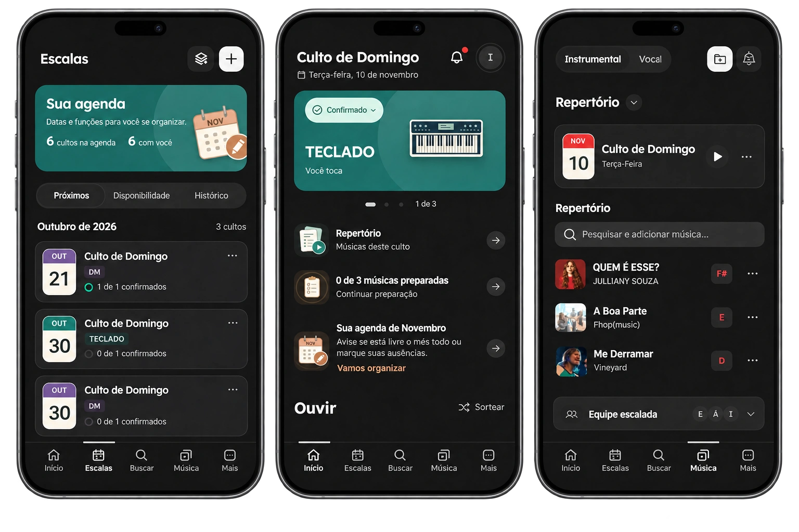

# Ministério da Música

### Sua equipe de louvor, na mesma sintonia.

Escalas, cifras e repertório em um só lugar. 
Uma plataforma para organizar a equipe e preparar cada encontro.

**Em produção, com cerca de 30 usuários.**

**[Falar com o desenvolvedor](https://github.com/isaquegozzi)**

Mockups baseados nas telas do aplicativo. A interface pode mudar conforme a evolução do produto.

## Sobre o projeto

O Ministério da Música reúne a organização e a preparação musical de equipes de louvor. Líderes acompanham as escalas e os repertórios; integrantes consultam sua participação, confirmam presença e acessam as referências para o ensaio e o culto.

A proposta é simples: facilitar os combinados durante a semana para que a equipe chegue preparada ao encontro.

## O que a plataforma oferece

| Recurso | Na rotina da equipe |
| --- | --- |
| **Escalas e disponibilidade** | Organização de datas e funções, confirmação de participação e registro de indisponibilidades. |
| **Repertório por culto** | Músicas de cada encontro reunidas em uma referência compartilhada. |
| **Cifras e letras** | Consulta, edição e organização do repertório musical. |
| **Tons por cantor** | Transposição de cifras e registro de preferências de tom. |
| **Preparação musical** | Acesso a músicas, vídeos e materiais de estudo antes do ensaio. |
| **Notificações** | Avisos sobre mudanças no repertório e na organização da equipe. |
| **Perfis de acesso** | Recursos organizados conforme as funções de administrador, líder e membro. |

## Do planejamento ao encontro

1. **Organizar:** definir a escala, as funções e o repertório.
2. **Combinar:** acompanhar a disponibilidade e as confirmações da equipe.
3. **Preparar:** consultar as músicas, revisar as cifras e conferir os tons.
4. **Participar:** abrir as referências do encontro no celular, tablet ou computador.

## Sobre este repositório

Este é o repositório público de apresentação do projeto. Contém apenas esta documentação e a imagem de divulgação. O código-fonte da aplicação é mantido em um repositório privado.

Para conhecer o projeto ou conversar sobre seu uso, entre em contato pelo **[perfil de Isaque Gozzi no GitHub](https://github.com/isaquegozzi)**.
